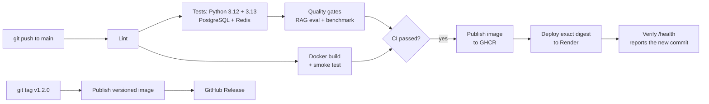

# Deploying NexusAI with CI/CD

This guide takes the project from your laptop to a live URL that redeploys itself on every push to `main`.

## How the pipeline works



| Workflow | Runs on | What it does |
| --- | --- | --- |
| `ci.yml` | Every push and pull request | Lint (ruff); tests on Python 3.12 and 3.13 against real PostgreSQL+pgvector and Redis with a 90% coverage gate; RAG retrieval and benchmark quality gates; Docker build, start, health check, API smoke test, and a check that no `.env` was baked into the image |
| `cd.yml` | CI success on `main`; tags `v*` | Builds and pushes the image to GitHub Container Registry (`latest`, `sha-<commit>`, and version tags), deploys that exact digest to Render, then polls `/health` until the new commit is live. Tags also create a GitHub Release |
| `dependabot.yml` | Weekly | Pull requests for Python packages, GitHub Actions and the Docker base image; each one runs CI before you merge |

Nothing deploys unless CI passed for that exact commit. If the Render secret isn't set, CD still publishes images and skips the deploy with a notice.

## 1. Push the project to GitHub

Create an empty repository on GitHub (for example `nexusai`, public so recruiters can see it), then from the project folder:

```bash
git init
git add .
git status            # check that .env and .venv are NOT listed (they are in .gitignore)
git commit -m "NexusAI: LLM gateway with RAG"
git branch -M main
git remote add origin https://github.com/<your-username>/nexusai.git
git push -u origin main
```

Open the **Actions** tab: CI starts immediately and takes about 3 to 5 minutes. When it passes, CD publishes the image.

## 2. Make the container image public

The first CD run creates the package `ghcr.io/<your-username>/nexusai`. Packages start private, and Render needs to pull it:

GitHub profile → **Packages** → `nexusai` → **Package settings** → **Change visibility** → **Public**.

(Alternatively, keep it private and add a GitHub token as a registry credential in Render.)

## 3. Create the service on Render

1. Sign up at [render.com](https://render.com) and choose **New → Web Service → Existing image**.
2. Image URL: `ghcr.io/<your-username>/nexusai:latest`
3. Instance type: **Free**. It sleeps after 15 minutes without traffic and takes about a minute to wake.
4. Health check path: `/health`
5. Environment variables:

| Key | Value |
| --- | --- |
| `GEMINI_API_KEY` | your Gemini key |
| `NEXUS_PROVIDER_MODE` | `live` |
| `RAG_MIN_SCORE` | `0.62` (or the value `smoke_live.py` suggested) |
| `NEXUS_INGEST_ON_START` | `data/sample_docs` (reloads the demo docs after every restart) |
| `NEXUS_API_KEY` | a long random string (protects `/v1/*`) |
| `NEXUS_ADMIN_API_KEY` | a different long random string (protects the admin API) |

Generate random keys with:

```bash
python -c "import secrets; print(secrets.token_urlsafe(32))"
```

**Always set both keys on a public URL.** Without them anyone could use up your Gemini quota.

Deploy once by hand and open `https://<your-service>.onrender.com/health`.

## 4. Connect Render to the pipeline

1. In Render, open the service's **Settings → Deploy Hook** and copy the URL.
2. In GitHub, open the repository's **Settings → Secrets and variables → Actions**:
   - **Secrets** tab → New secret `RENDER_DEPLOY_HOOK_URL` = the deploy hook URL
   - **Variables** tab → New variable `DEPLOY_URL` = `https://<your-service>.onrender.com`
3. Optional: **Settings → Environments → production → Required reviewers** adds a manual approval before each deploy.

From now on, every push to `main` that passes CI is deployed automatically, and the pipeline fails if the live site doesn't report the new commit within 10 minutes.

## 5. Releases

```bash
git tag v1.2.0
git push origin v1.2.0
```

This publishes `ghcr.io/<your-username>/nexusai:1.2.0` and creates a GitHub Release with generated notes.

## Limits of the free setup

- **In-memory store:** with no `DATABASE_URL`/`REDIS_URL`, the request log, caches and documents reset on every restart or deploy. `NEXUS_INGEST_ON_START` reloads the demo documents automatically.
- **One worker:** in-memory state is per process, so the image runs one worker with 8 threads. With PostgreSQL and Redis configured, raise `NEXUS_WORKERS`.
- **Cold starts:** the free instance sleeps when idle; the first request after a while takes about a minute.
- **Persistent production setup:** add a managed PostgreSQL with pgvector and a Redis instance, set `DATABASE_URL` and `REDIS_URL`, and the same image runs with durable state. Render's free PostgreSQL expires after 30 days, so use a paid or external database for anything long-lived.

## Run the production image locally

```bash
docker compose up --build    # gateway + PostgreSQL/pgvector + Redis, 4 workers
```
