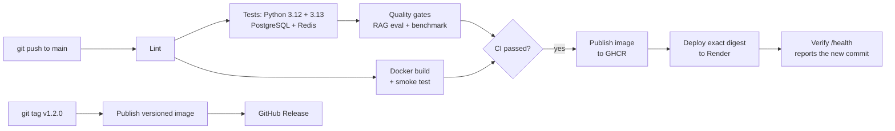

# Deploying NexusAI

This guide takes NexusAI from your laptop to a live URL that updates itself every time you push to `main`. It takes about 20 minutes, and everything here is free.

## The big picture



When you push, GitHub runs two workflows, one after the other.

**CI** checks that the code is healthy. It runs the linter and the tests against real PostgreSQL and Redis, and it fails if document retrieval gets worse or the cache serves a wrong answer. It also builds the Docker image, starts it and calls the API to make sure it really works. It runs on every push and every pull request.

**CD** ships it. It runs only when CI passes on `main`. It publishes the Docker image to GitHub Container Registry (GHCR), tells Render to deploy that exact image, and waits until the live site reports the new commit. If you haven't connected Render yet, it still publishes the image and skips the deploy step.

**Dependabot** opens at most one grouped pull request a month each for Python packages, GitHub Actions and the Docker base image, and CI tests each one before you merge.

Nothing gets deployed unless CI passed for that exact commit.

## 1. Push the project to GitHub

Create an empty repository on GitHub called `nexusai`. Make it public if you want recruiters to see it. Then run this from the project folder:

```bash
git init
git add .
git status            # make sure .env and .venv are NOT listed
git commit -m "NexusAI: LLM gateway with RAG"
git branch -M main
git remote add origin https://github.com/santhoshkumaar160302-ship-it/nexusai.git
git push -u origin main
```

Open the **Actions** tab on GitHub. CI starts right away and takes 3 to 5 minutes. When it goes green, CD publishes the image.

## 2. Let Render pull the image

The first CD run creates a package at `ghcr.io/santhoshkumaar160302-ship-it/nexusai`. GitHub makes new packages private, and Render needs to be able to download yours. You have two options:

- **Make the package public (easiest).** On GitHub, go to your profile, then **Packages** → `nexusai` → **Package settings** → **Change visibility** → **Public**. This only exposes the built image, and your API key is never in it.
- **Keep it private.** Create a GitHub personal access token with only the `read:packages` permission, and add it in Render as a registry credential (your GitHub username plus the token).

## 3. Create the service on Render

1. Sign up at [render.com](https://render.com), then choose **New → Web Service → Existing image**.
2. For the image URL, enter `ghcr.io/santhoshkumaar160302-ship-it/nexusai:latest`.
3. Pick the **Free** instance type. It goes to sleep after 15 minutes without visitors and takes about a minute to wake up.
4. Set the health check path to `/health`.
5. Add these environment variables:

| Key | Value |
| --- | --- |
| `GEMINI_API_KEY` | your Gemini key |
| `NEXUS_PROVIDER_MODE` | `live` |
| `RAG_MIN_SCORE` | `0.62`, or whatever `smoke_live.py` suggested |
| `NEXUS_INGEST_ON_START` | `data/sample_docs`, so the demo documents come back after every restart |
| `NEXUS_API_KEY` | a long random string that protects the `/v1` API |
| `NEXUS_ADMIN_API_KEY` | a different long random string that protects the admin API |

You can generate the random strings with:

```bash
python -c "import secrets; print(secrets.token_urlsafe(32))"
```

**Don't skip the two keys.** Without them, anyone who finds your URL can use up your Gemini quota.

Deploy once by hand, then open `https://<your-service>.onrender.com/health` to check it's up.

## 4. Connect Render to GitHub

This step lets CD deploy for you.

1. In Render, open your service's **Settings**, find **Deploy Hook**, and copy the URL.
2. In GitHub, open the repository's **Settings → Secrets and variables → Actions**.
   - On the **Secrets** tab, add `RENDER_DEPLOY_HOOK_URL` with the deploy hook URL.
   - On the **Variables** tab, add `DEPLOY_URL` with `https://<your-service>.onrender.com`.
3. Optionally, go to **Settings → Environments → production** and add yourself as a required reviewer if you'd like to approve each deploy by hand.

That's it. From now on, every push to `main` that passes CI goes live automatically. If the site doesn't report the new commit within 10 minutes, the pipeline fails so you know something's wrong.

## 5. Releasing a version

```bash
git tag v1.2.0
git push origin v1.2.0
```

This publishes `ghcr.io/santhoshkumaar160302-ship-it/nexusai:1.2.0` and creates a GitHub Release with notes written from your commits.

## What to expect from the free setup

- **Data resets on restart.** Without a database, the request history, cache and uploaded documents live in memory and disappear on every restart or deploy. The sample documents are reloaded automatically because of `NEXUS_INGEST_ON_START`.
- **One worker.** Because that state is in memory, the image runs a single worker with 8 threads. Once you add PostgreSQL and Redis, you can raise `NEXUS_WORKERS`.
- **Slow first request.** The free instance sleeps when nobody's using it, so the first visit after a while takes about a minute.
- **Making it permanent.** Add a managed PostgreSQL (with pgvector) and a Redis, set `DATABASE_URL` and `REDIS_URL`, and the same image keeps its data across restarts. Render's free PostgreSQL expires after 30 days, so use a paid or external database for anything you want to keep.

## Running the production setup locally

```bash
docker compose up --build    # gateway + PostgreSQL/pgvector + Redis, 4 workers
```