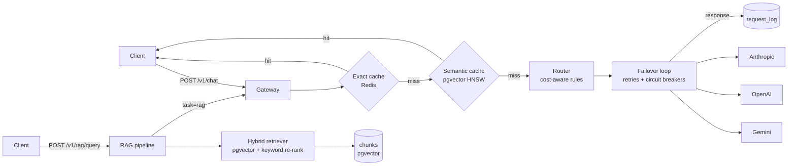

# NexusAI


**Live demo:** [nexusai-latest.onrender.com](https://nexusai-latest.onrender.com). It runs on Render's free tier, so the first visit after a quiet spell can take about a minute to wake up.

NexusAI is a gateway that sits between your app and the AI providers (Google Gemini, OpenAI and Anthropic). Your app sends every request to one place in one format, and the gateway takes care of the annoying parts:

- **It picks the model.** Simple questions go to a cheap, fast model and harder ones go to a stronger model, based on rules you can edit while it runs.
- **It doesn't fall over.** If a model errors out or hits its rate limit, the gateway retries and moves on to another model, so the user still gets an answer.
- **It remembers answers.** Repeated questions, and questions that mean the same thing in different words, are answered from a cache instead of paying for another API call.
- **It can answer from your documents.** Upload your docs and ask questions about them. Answers cite the exact sections they came from, and when the docs don't cover a question, it says it doesn't know instead of making something up (this is called RAG).
- **It shows you what happened.** Every request is logged with its cost, timing and which models were tried, and traced with OpenTelemetry.

It runs fully live on Gemini's free tier, and it also runs completely offline with simulated providers, so you can try every feature without an API key.

**Built with:** Python, Flask, PostgreSQL with pgvector, Redis, OpenTelemetry, plain JavaScript/HTML/CSS for the UI, Docker and GitHub Actions.

## Try the live demo

Open [nexusai-latest.onrender.com](https://nexusai-latest.onrender.com) and try these:

- **Ask** tab: "Which HTTP status codes does the gateway retry?" You get an answer with numbered citations. Click a number to see the exact passage it came from.
- **Ask** tab: follow up with "and which ones does it never retry?", then say "continue". Ask remembers the conversation; click an answer to see what it actually searched for.
- **Ask** tab: "Who won the 2022 World Cup?" The sample documents don't cover this, so it says it doesn't know instead of guessing.
- **Chat** tab: "Explain step by step how a TCP handshake works." "Step by step" sends it to the strongest model; the inspector on the right shows which one answered and why.
- **Chat** tab: ask "What is a Bloom filter?", then follow up with "When would I use one instead of a hash set?" It remembers the conversation, so "one" means a Bloom filter. **New chat** starts over.
- **Chat** tab: send the same message twice. The second reply comes from the cache, instantly and for $0.
- **Monitor** tab: requests, cost, cache hits and failovers since the server started.
- The button at the bottom of the sidebar switches between light, dark and your system's setting.

Or call the API directly from a terminal:

```bash
# Ask the sample documents (answer, citations and the sources used)
curl -s -X POST https://nexusai-latest.onrender.com/v1/rag/query \
  -H 'content-type: application/json' \
  -d '{"question": "How does the semantic cache work?"}'

# Chat through the gateway
curl -s -X POST https://nexusai-latest.onrender.com/v1/chat \
  -H 'content-type: application/json' \
  -d '{"messages": [{"role": "user", "content": "What is a Bloom filter?"}]}'

# A follow-up: send the earlier turns along with the new question
curl -s -X POST https://nexusai-latest.onrender.com/v1/chat \
  -H 'content-type: application/json' \
  -d '{"messages": [
        {"role": "user", "content": "What is a Bloom filter?"},
        {"role": "assistant", "content": "A Bloom filter is a space-efficient probabilistic set that can say an item is definitely not present or possibly present."},
        {"role": "user", "content": "When would I use one instead of a hash set?"}
      ]}'

# Health, version and the models it can use
curl -s https://nexusai-latest.onrender.com/health
```

The API itself doesn't store conversations: like the OpenAI and Gemini APIs, you send the earlier turns with each request, which is exactly what the Chat tab does for you. Each reply includes which model answered, whether it came from the cache, the tokens, the cost and the route it took. If the first request is slow, the free instance was asleep; give it a minute.

## How a request flows through it



When a chat request comes in:

1. The gateway first checks whether it has seen this **exact request** before (a hash lookup in Redis).
2. If not, it checks for a **near-identical question** asked earlier in the same context, by comparing embeddings in pgvector.
3. Still nothing? The **router** reads the request and picks a tier: economy, standard or premium. It tries the cheapest model in that tier first.
4. If that model fails, the **failover loop** retries with backoff, then tries the next model. If the whole tier is struggling, it goes one tier up and finally falls back to cheaper tiers, because a cheaper answer beats an error. Circuit breakers stop it from hammering a provider that's clearly down.
5. The answer is cached, and the tokens, cost and latency are recorded.

## What's inside

| Part | What it does | Where |
| --- | --- | --- |
| Providers | Gemini, OpenAI and Anthropic behind one interface. The small differences between their APIs (where the system prompt goes, which models don't accept a temperature) are handled inside each adapter. | `nexusai/providers/` |
| Routing | Rules based on the task, keywords and prompt length decide the tier. Only providers you have keys for are used. | `nexusai/routing.py`, `pricing.py` |
| Failover | Retries with jittered backoff and a circuit breaker per provider. Rate limits (429) send the request to the next model's quota without marking the provider as broken. | `nexusai/gateway.py`, `resilience.py` |
| Caching | An exact cache in Redis plus a semantic cache in pgvector. If the embedding API goes down, the cache simply misses and the request is still answered. | `nexusai/cache.py` |
| Embeddings | Gemini `gemini-embedding-001` at 768 dimensions, OpenAI, or an offline hashing embedder for testing. | `nexusai/embeddings.py` |
| RAG | Splits documents at their headings, finds relevant sections with a mix of meaning and keyword matching, and writes answers with numbered citations. | `nexusai/rag/` |
| Evaluation | Measures whether retrieval finds the right document and whether answers cite correctly and abstain when they should. | `nexusai/rag/evaluation.py`, `scripts/eval_rag.py` |
| Observability | OpenTelemetry spans for each request, cache lookup and provider call, plus counters for tokens and cost and a SQL request log. | `nexusai/telemetry.py` |
| Console UI | A web console for asking your documents, chatting, managing documents, monitoring and editing settings. Chat remembers the conversation (the last 10 exchanges) until you start a new one, and answers are shown with their formatting. Ask also takes follow-ups and "continue". Light and dark themes, or follow the system. Click any answer to open the request inspector: which model answered, time, cost, tokens, a timeline of every model it tried, and the sources it used. | `nexusai/static/` |
| Benchmarks | A load test that injects failures and checks every cached answer against ground truth. | `scripts/benchmark.py` |

## Getting started

### Try it offline (no API keys, no databases)

```bash
pip install -r requirements-dev.txt
python -m nexusai.app            # then open http://localhost:8000
pytest
python scripts/eval_rag.py
python scripts/benchmark.py --requests 10000
```

In this mode the AI providers are simulated, so nothing costs money. In the console, go to **Docs**, click **Load samples**, then ask a question on the **Ask** tab.

### Run it live on Gemini's free tier

1. Get a free key from [Google AI Studio](https://aistudio.google.com/apikey).
2. Copy `.env.example` to `.env` and set:

   ```
   GEMINI_API_KEY=your-key
   NEXUS_PROVIDER_MODE=live
   ```

3. Start the console with `python -m nexusai.app` and open http://localhost:8000.

To measure answer quality with real answers, run `python scripts/eval_rag.py --answers --delay 7` (the delay keeps you under the free tier's per-minute limit). `python scripts/smoke_live.py` is an optional quick check that also suggests thresholds for real embeddings.

Google may use free-tier requests to improve its products, so don't send anything private.

### Run the full stack with Docker

```bash
cp .env.example .env             # add GEMINI_API_KEY and set NEXUS_PROVIDER_MODE=live
docker compose up --build
python scripts/ingest_dir.py data/sample_docs --url http://localhost:8000
```

Then open `http://localhost:8000`.

## Using the API

If you set `NEXUS_API_KEY`, send it with every `/v1` request as `X-API-Key` (or `Authorization: Bearer ...`). The `/admin/api` routes use `NEXUS_ADMIN_API_KEY` instead.

**Chat**

```bash
curl -X POST localhost:8000/v1/chat -H 'content-type: application/json' -d '{
  "messages": [{"role": "user", "content": "What is a Bloom filter?"}],
  "model": "auto", "temperature": 0, "max_tokens": 300
}'
```

You get back the answer along with which model and tier handled it, whether it came from the cache, the token counts, cost, latency and the route it took. You can also pin a `model`, force a `tier`, or turn the cache off with `"cache": false`.

**Asking your documents**

```bash
# add a document
curl -X POST localhost:8000/v1/rag/ingest -H 'content-type: application/json' -d '{
  "documents": [{"title": "Caching", "source": "docs/caching.md", "text": "# Caching\n..."}]}'

# ask a question (returns the answer, citations and the sources it used)
curl -X POST localhost:8000/v1/rag/query -H 'content-type: application/json' \
  -d '{"question": "What is the semantic cache threshold?", "top_k": 5}'

# see what retrieval finds, without generating an answer
curl -X POST localhost:8000/v1/rag/search -H 'content-type: application/json' -d '{"query": "circuit breaker"}'
```

Other routes: `GET /health`, `GET /v1/models`, `GET /v1/rag/documents`, `DELETE /v1/rag/documents/<id>`, `GET /admin/api/stats`, `GET /admin/api/requests`, `GET /admin/api/providers`, `GET|PUT /admin/api/rules`, `POST /admin/api/rules/reset` and `POST /admin/api/stats/reset`.

## How the document Q&A works

1. **Splitting.** Each Markdown document is split at its headings, and each section is packed into chunks of about 800 characters, with about 150 characters of overlap so a sentence isn't cut off from its context. A chunk never spans two sections.
2. **Adding context.** Before a chunk is embedded, its document title and heading path are added to the front. A short chunk like "Set it to 0.95" still gets found when someone asks about cache thresholds.
3. **Skipping work.** Each document is hashed, so re-uploading an unchanged document costs nothing.
4. **Finding the right sections.** The retriever pulls a wide set of candidates by meaning, then re-ranks them with 75% meaning and 25% keyword overlap. It drops anything below a relevance floor and takes at most 3 chunks from any one document.
5. **Answering with citations.** The model sees numbered sources and is told to cite them as `[n]` and to say so when the sources don't contain the answer. Answers go through the gateway like any other request, so they get routing, failover, caching and cost tracking too.
6. **Knowing when to stop.** If nothing clears the relevance floor, it answers "I don't know" right away without calling a model at all.
7. **Follow-up questions.** Ask remembers the last three questions. A follow-up like "and how long does it stay open?" is useless as a search on its own, so a cheap model first rewrites it into a full question ("How long does a circuit breaker stay open?"), and that is what gets searched. "Continue" skips the rewrite: it searches the previous question again, gets the same sources, and asks the model to pick up where its last answer stopped. The inspector shows what was searched for.

### Measuring it

```bash
python scripts/eval_rag.py --docs data/sample_docs --questions data/eval_questions.jsonl            # retrieval only
python scripts/eval_rag.py --docs data/sample_docs --questions data/eval_questions.jsonl --answers  # plus answers
```

The question set is in JSON Lines, one question per line: `{"question": ..., "relevant_sources": [...], "answer_keywords": [...]}`. Questions the documents can't answer have an empty `relevant_sources`, so the eval can check that the system abstains.

On the 8 bundled documents (33 questions, 4 of which can't be answered):

| Metric | Live (Gemini embeddings and answers) | Offline (hashing embedder) |
| --- | --- | --- |
| Right document in the top 5 (hit@5) | 100% | 96.6% |
| Mean reciprocal rank (MRR) | 1.0 | 0.966 |
| Correctly says "I don't know" | 100% | 75% (3 of 4) |

Offline, one unanswerable question slips through because it shares the word "NexusAI" with the architecture doc. The hashing embedder only matches words, not meaning, and the live Gemini embeddings don't make that mistake.

## Benchmarks

```bash
python scripts/benchmark.py --requests 100000                       # in-process, simulated providers
python scripts/benchmark.py --requests 10000 --thresholds 0.92,0.95,0.97
python scripts/benchmark.py --url http://localhost:8000 --requests 1000 --api-key ... --admin-key ...
python scripts/benchmark.py --prompts my_traffic.jsonl              # replay your own prompts
```

The in-process benchmark tries hard to break things. 3% of provider calls fail at random, and OpenAI goes completely down for 5% of the run. It simulates 20 requests per second so the circuit breakers see realistic timing. Every prompt is labelled as a new question, an exact repeat or a rephrasing. Every "new" question is genuinely different, so if the semantic cache ever answers one with someone else's answer, that's counted as a **wrong hit**.

Savings are reported in three parts so neither one inflates the other:

- **saved by caching:** what was actually spent versus the same routing with no cache
- **saved by routing:** the routed models versus sending every request to one strong baseline model
- **total savings:** what was actually spent versus that baseline

How much the cache saves depends entirely on how repetitive the traffic is. The default mix has 18% exact repeats and 12% rephrasings, so quote that alongside the numbers, or replay real traffic with `--prompts`.

### 100,000 requests

The workload was 70,003 distinct questions (20% reasoning-heavy, 5% long), 17,939 exact repeats and 12,058 rephrasings, with 3% random failures and OpenAI down for 5,000 requests.

| Metric | Result |
| --- | --- |
| Success rate | 100.00% (0 failed, 3,879 failovers) |
| Requests served from cache | 24.38% (21,052 exact, 3,329 semantic) |
| Wrong cached answers | 0 |
| Saved by caching | 21.15% |
| Saved by routing (vs. everything on claude-sonnet-4-5) | 56.50% |
| Total cost savings | 65.70% |
| Gateway overhead, median / 95th percentile | 6.5 ms / 20.2 ms |

The latency here is only the gateway's own overhead, since the simulated providers answer instantly. Token counts are estimated from text length in this mode, so run it live for real cost figures.

### Gemini only

`MOCK_PROVIDERS=gemini python scripts/benchmark.py --requests 10000` simulates a setup with just a Gemini key, and savings are measured against `gemini-3.8-flash`:

| Metric | Result |
| --- | --- |
| Success rate | 100% (0 failed out of 10,000, with 3% injected errors) |
| Wrong cached answers | 0 |
| Saved by caching / routing / total | 22.2% / 25.1% / 41.7% |

With one provider there's no outage to escape from, so failover happens between Gemini models.

### Choosing how similar is "similar enough"

The semantic cache needs a similarity threshold. Set it too low and different questions share answers. Here's the sweep over 10,000 requests with the offline embedder:

| Threshold | Semantic hits | Wrong hits | Saved by caching |
| --- | --- | --- | --- |
| 0.92 | 929 | 143 | 23.4% |
| 0.95 | 545 | 16 | 22.7% |
| 0.97 | 332 | 0 | 21.2% |

At 0.92, "explain X for a beginner" and "explain X for a senior engineer" end up with the same answer, which is wrong. So the default is 0.97 for the offline embedder and 0.95 for real embeddings. If you rely on the cache, re-run the sweep with live embeddings and your own traffic.

## Configuration

Every setting is listed in `.env.example`. These are the ones you're most likely to change:

| Variable | Default | What it's for |
| --- | --- | --- |
| `NEXUS_PROVIDER_MODE` | `mock` | Set to `live` to call real APIs |
| `GEMINI_API_KEY` | | Your Gemini key (the free tier works). Turns on Gemini chat and embeddings |
| `OPENAI_API_KEY`, `ANTHROPIC_API_KEY` | | Optional extra providers |
| `GEMINI_REASONING_EFFORT` | | Optional thinking level for Gemini: `low`, `medium` or `high` |
| `NEXUS_EMBEDDINGS` | auto | `gemini`, `openai` or `hash` |
| `MOCK_PROVIDERS` | `openai,anthropic` | Which providers to simulate offline, e.g. `gemini` |
| `DATABASE_URL`, `REDIS_URL` | in-memory | PostgreSQL with pgvector, and Redis |
| `NEXUS_SEMANTIC_THRESHOLD` | 0.95 / 0.97 | How similar a question must be to reuse an answer (real / offline embeddings). `smoke_live.py` suggests a value |
| `NEXUS_MAX_RETRIES` | 2 | Retries per model before moving on |
| `NEXUS_BREAKER_THRESHOLD`, `NEXUS_BREAKER_RESET_S` | 5, 30 | Failures before a provider is skipped, and how long to wait before trying it again |
| `RAG_CHUNK_SIZE`, `RAG_CHUNK_OVERLAP`, `RAG_TOP_K` | 800, 150, 5 | Document splitting and how many sources to use |
| `NEXUS_BASELINE_MODEL` | auto | What savings are compared against: `gemini-3.8-flash` with only Gemini, otherwise `claude-sonnet-4-5` |
| `OTEL_EXPORTER_OTLP_ENDPOINT` | | Where to send traces and metrics |

Model prices are in `nexusai/pricing.py`. Check them against the providers' pricing pages before you quote any cost numbers.

## CI/CD

The two badges at the top show whether the latest build passed.

**CI** (`.github/workflows/ci.yml`) runs on every push and pull request. It checks the code style with ruff and runs the tests on Python 3.12 and 3.13 against real PostgreSQL and Redis, requiring at least 90% coverage. It also fails the build if document retrieval gets worse, if the benchmark's success rate drops below 99.9%, or if the cache serves a single wrong answer. Finally it builds the Docker image, starts it, calls the API, and makes sure no `.env` file slipped into the image.

**CD** (`.github/workflows/cd.yml`) runs only after CI passes on `main`. It publishes the Docker image to GitHub Container Registry, tells Render to deploy that exact image, and then watches `/health` until the live site reports the new commit. Pushing a version tag like `v1.2.0` also creates a GitHub Release.

Dependabot keeps dependencies up to date, but quietly: at most one grouped pull request a month each for Python packages, GitHub Actions and Docker, and CI runs on each one before you merge.

The full setup is in [DEPLOYMENT.md](DEPLOYMENT.md).

## Tests

```bash
pytest                                                          # unit and API tests, in memory
NEXUS_TEST_DATABASE_URL=postgresql://... NEXUS_TEST_REDIS_URL=redis://.../15 pytest --cov=nexusai
```

There are 111 tests. They cover routing (including Gemini-only setups), failover, rate limits, circuit breakers, both caches, and the Gemini, OpenAI and Anthropic adapters against a mocked HTTP layer. They also cover embedding outages, document splitting, retrieval, citations, the HTTP API and its auth, and the PostgreSQL and Redis backends. Coverage is 94% when the database tests run, and CI always runs them against real containers.

## Project layout

```
nexusai/
  app.py              the Flask app and HTTP API
  gateway.py          cache → route → failover → record
  routing.py          the rule engine and model selection
  pricing.py          model catalog and prices
  resilience.py       circuit breaker and backoff
  cache.py            exact cache and namespaces
  embeddings.py       Gemini, OpenAI and offline embedders
  telemetry.py        OpenTelemetry setup
  providers/          Gemini, OpenAI, Anthropic and simulated adapters
  storage/            in-memory and PostgreSQL/pgvector storage
  rag/                splitting, ingestion, retrieval, answering, evaluation
  static/             the web console (HTML, CSS, JS)
scripts/              benchmark, RAG eval, live check, folder ingestion
data/                 sample documents and eval questions
tests/                the pytest suite
```

## Decisions worth explaining

- **Some prompts skip the semantic cache.** Long prompts and document Q&A prompts are mostly shared context, so their embeddings look alike even when the actual questions differ. The benchmark's wrong-hit check caught this. Cached answers are also kept separate by system prompt, conversation history, pinned model and task.
- **Some errors aren't worth retrying.** A 400 means the request itself is broken, so trying another provider won't help, and the gateway fails straight away. A 401, 403 or 404 is about one provider's key or model list, so it moves on to the next provider. A 429, a 5xx or a timeout gets retried with backoff.
- **What counts as a failover.** Only an answer from a different model than the router first chose. A retry that succeeds on the same model doesn't count.
- **A cheaper answer beats an error.** If the chosen tier and the one above it both fail, the router tries cheaper tiers. I found this one live: on Gemini's free tier the Flash models ran out of quota mid-eval while Flash-Lite still had some left.
- **A rate limit isn't an outage.** Free-tier quotas are per model, so a 429 skips to the next model without tripping the circuit breaker, and one delayed second pass picks up the per-minute limits once they reset.
- **The cache is never something requests depend on.** If the embedding API is down, chat still works and just misses the cache. Document Q&A returns a clear 503, since it can't search without an embedding.
- **768-dimension embeddings.** Gemini returns 3,072 dimensions by default, but pgvector's HNSW index tops out at 2,000. Google recommends 768 as a smaller size, and the vectors are re-normalized after shortening.
- **Rewrite follow-ups before searching.** Searching with "and the second one?" finds nothing useful, and searching with the whole conversation drowns the new question in old text. Rewriting the follow-up into one standalone question costs a single economy-tier call and keeps retrieval sharp. Rewrites skip the cache: the transcript dominates that prompt, so two different follow-ups could look alike to the semantic cache. If no model answers, it searches with the previous question plus the follow-up instead.
- **One embedding per request.** The embedding used to check the cache is reused when storing the answer, which halves embedding calls on cache misses.
- **Cut-off answers are flagged, never cached.** When a model hits its token limit it stops mid-sentence. The gateway detects that (`finish_reason: length` from OpenAI and Gemini, `stop_reason: max_tokens` from Anthropic), marks the answer as truncated so the UI can say so, and doesn't cache it, so asking again gets a fresh answer instead of the broken one. I found this one live: the first default limit of 512 tokens cut off longer answers, so the default is now 2,048.
- **Chat history has a cap.** Each chat message carries the earlier conversation so follow-ups make sense, but only the last 10 exchanges, so a long chat doesn't make every message more expensive than the last. Cached answers are keyed by the whole conversation, so "tell me more" in one chat never replays an answer from another.
- **Circuit breaker state lives in memory.** That's simple and fast for one instance. With several replicas it should move to Redis so they all agree on which providers are healthy.
- **A pgvector limitation.** Before pgvector 0.8, filtering by namespace after an HNSW scan can miss entries. The worst case is a cache miss, never a wrong answer, and pgvector 0.8's iterative scans fix it.