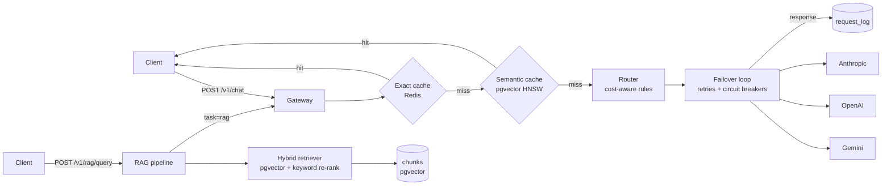

# NexusAI: Fault-Tolerant LLM Gateway with RAG


NexusAI is a single HTTP gateway in front of Google Gemini, OpenAI and Anthropic. It runs fully live on Gemini's free tier, and uses whichever providers have a key. Applications send one request format; the gateway picks the cheapest model that fits the request, retries and fails over when a provider errors, caches answers (exact and semantic), and answers questions over your own documents with cited sources (RAG). Every request is traced with OpenTelemetry and logged with its cost.

**Stack:** Python, Flask, PostgreSQL + pgvector, Redis, OpenTelemetry, vanilla JavaScript/HTML/CSS admin UI, Docker, GitHub Actions.

## Architecture



Request flow for `POST /v1/chat`:

1. **Exact cache** (Redis): SHA-256 of the normalized request.
2. **Semantic cache** (pgvector): embed the prompt, return a cached answer for a near-identical earlier prompt in the same context namespace.
3. **Router**: the first matching rule picks a tier; candidates are that tier's models cheapest-first, then the next tier up, then lower tiers as a last resort (a cheaper answer beats an error).
4. **Failover loop**: each candidate gets up to 3 attempts with exponential backoff and jitter; circuit breakers skip unhealthy providers; 401/403/404 move to the other provider; 400 fails fast.
5. **Record**: cache the answer, log tokens, cost and latency, emit OTel spans and metrics.

## Features

| Area | What it does | Code |
| --- | --- | --- |
| Provider adapters | Gemini (OpenAI-compatible endpoint), OpenAI Chat Completions and Anthropic Messages behind one interface; Anthropic's system prompt moved to its top-level field; reasoning models sent without temperature | `nexusai/providers/` |
| Cost-aware routing | JSON rules (task, keywords, prompt size) → tier; cheapest healthy model first among configured providers; escalation one tier up, then graceful degradation to lower tiers; editable at runtime | `nexusai/routing.py`, `pricing.py` |
| Failover | Retries with full-jitter backoff, per-provider circuit breakers (closed / open / half-open), provider-specific error handling, rate limits (429) routed to the next model's quota without tripping breakers | `nexusai/gateway.py`, `resilience.py` |
| Caching | Exact (Redis, TTL) + semantic (pgvector HNSW, cosine threshold) with context namespaces; skips high-temperature, long and RAG prompts for the semantic tier; an embedding outage degrades to a cache miss | `nexusai/cache.py` |
| Embeddings | Gemini `gemini-embedding-001` at 768 dims with task types (document / query / similarity), OpenAI, or an offline hashing embedder; retries with Retry-After | `nexusai/embeddings.py` |
| RAG | Markdown-aware chunking with overlap, contextual chunk headers, idempotent ingestion, hybrid retrieval, cited answers, no-LLM answer when nothing relevant is found | `nexusai/rag/` |
| Evaluation | hit@k, recall@k, MRR; citation precision, keyword accuracy, abstention accuracy | `nexusai/rag/evaluation.py`, `scripts/eval_rag.py` |
| Observability | OTel spans per request, cache lookup and provider attempt; counters for requests, tokens, cost; latency histogram; SQL request log | `nexusai/telemetry.py` |
| Admin UI | Stats, provider health, routing-rule editor, RAG playground, recent requests | `nexusai/static/` |
| Benchmarks | Load benchmark with fault injection and ground-truth cache checking; threshold sweep | `scripts/benchmark.py` |

## Quick start

### Offline (no API keys, no databases)

```bash
pip install -r requirements-dev.txt
python -m nexusai.app            # http://localhost:8000/admin
pytest                           # unit tests
python scripts/eval_rag.py       # RAG retrieval eval on the sample docs
python scripts/benchmark.py --requests 10000
```

Mock mode uses simulated providers and an offline hashing embedder, so every feature runs without spending money.

### Live on Gemini's free tier

1. Create a key at [Google AI Studio](https://aistudio.google.com/apikey).
2. Run the live check (about 15 API calls; it also suggests cache and RAG thresholds for real embeddings):

```bash
export GEMINI_API_KEY=your-key
python scripts/smoke_live.py
```

3. Run the gateway and the RAG eval with real answers (the delay keeps you under free-tier per-minute limits):

```bash
export NEXUS_PROVIDER_MODE=live
python -m nexusai.app
python scripts/eval_rag.py --answers --delay 7
```

Settings can also live in a `.env` file in the project folder (copy `.env.example`); it is loaded automatically, and exported variables take precedence. The eval prints progress per question, waits out rate limits (60 s, up to twice) and records any question it still cannot answer instead of stopping.

With only a Gemini key, chat routes to Gemini models (Flash-Lite → Flash), embeddings use `gemini-embedding-001`, and cost savings are reported against `gemini-3.8-flash` at Google's paid list prices. Free-tier requests may be used by Google to improve its products, so don't send private data. OpenAI and Anthropic adapters stay available: add their keys and the router uses them too.

### Full stack with Docker

```bash
cp .env.example .env             # add GEMINI_API_KEY and set NEXUS_PROVIDER_MODE=live
docker compose up --build
python scripts/ingest_dir.py data/sample_docs --url http://localhost:8000
```

Open `http://localhost:8000/admin` for the admin UI.

## API

All `/v1` routes accept `X-API-Key: $NEXUS_API_KEY` (or `Authorization: Bearer …`) when a key is set; `/admin/api` routes need `NEXUS_ADMIN_API_KEY`.

**Chat**

```bash
curl -X POST localhost:8000/v1/chat -H 'content-type: application/json' -d '{
  "messages": [{"role": "user", "content": "What is a Bloom filter?"}],
  "model": "auto", "temperature": 0, "max_tokens": 300
}'
```

The response includes `content`, `provider`, `model`, `tier`, `rule`, `cache` (`miss` / `exact` / `semantic`), token counts, `cost_usd`, `latency_ms`, `attempts` and `failover`. Optional fields: `model` (pin a model), `tier` (force a tier), `task`, `cache: false`.

**RAG**

```bash
# ingest
curl -X POST localhost:8000/v1/rag/ingest -H 'content-type: application/json' -d '{
  "documents": [{"title": "Caching", "source": "docs/caching.md", "text": "# Caching\n..."}]}'

# ask (answer + citations + retrieved sources)
curl -X POST localhost:8000/v1/rag/query -H 'content-type: application/json' \
  -d '{"question": "What is the semantic cache threshold?", "top_k": 5}'

# retrieval only (debugging)
curl -X POST localhost:8000/v1/rag/search -H 'content-type: application/json' -d '{"query": "circuit breaker"}'
```

Other routes: `GET /health`, `GET /v1/models`, `GET /v1/rag/documents`, `DELETE /v1/rag/documents/<id>`, `GET /admin/api/stats`, `GET /admin/api/requests`, `GET /admin/api/providers`, `GET|PUT /admin/api/rules`, `POST /admin/api/rules/reset`, `POST /admin/api/stats/reset`.

## RAG pipeline

1. **Chunking**: split Markdown at headings (tracking the heading path), pack paragraphs into ~800-character chunks, carry ~150 characters of sentence-aligned overlap. Chunks never cross sections.
2. **Contextual headers**: `title > heading path` is prepended to each chunk before embedding, so short chunks still retrieve for the right questions.
3. **Idempotent ingestion**: a SHA-256 content hash skips unchanged documents, so re-syncs only pay for changed ones.
4. **Hybrid retrieval**: fetch 4×k candidates by cosine similarity (HNSW), re-rank with `0.75 × vector + 0.25 × IDF keyword overlap`, drop chunks below the relevance floor, cap at 3 chunks per document.
5. **Grounded answers**: numbered sources in the prompt, instructions to cite `[n]` and abstain; citations are parsed and mapped back to documents. Answers go through the gateway (`task=rag`), so they get routing, failover, caching and cost tracking.
6. **No-context short circuit**: if nothing clears the relevance floor, answer "I don't know" without calling an LLM.

### Evaluating RAG

```bash
python scripts/eval_rag.py --docs data/sample_docs --questions data/eval_questions.jsonl          # retrieval
python scripts/eval_rag.py --docs data/sample_docs --questions data/eval_questions.jsonl --answers  # + answers
```

The eval set is JSON Lines: `{"question": ..., "relevant_sources": [...], "answer_keywords": [...]}`, with an empty `relevant_sources` for questions the corpus cannot answer.

Results on the bundled 8-document corpus (33 questions, 4 unanswerable), offline hashing embedder:

| Metric | Value |
| --- | --- |
| hit@5 | 96.6% |
| recall@5 | 93.1% |
| MRR | 0.966 |
| Abstention accuracy (no-context short circuit) | 75% (3 of 4) |

The one unanswerable question that slips past the relevance floor shares the word "NexusAI" with the architecture doc, a lexical false positive of the offline embedder; a real model then abstains from the irrelevant context. Answer metrics such as keyword accuracy only mean something with a real model: run `python scripts/eval_rag.py --answers --delay 4` with `NEXUS_PROVIDER_MODE=live` and a Gemini key (embeddings switch to `gemini-embedding-001`) to get live numbers.

## Benchmarking

```bash
python scripts/benchmark.py --requests 100000                       # in-process, simulated providers
python scripts/benchmark.py --requests 10000 --thresholds 0.92,0.95,0.97
python scripts/benchmark.py --url http://localhost:8000 --requests 1000 --api-key ... --admin-key ...
python scripts/benchmark.py --prompts my_traffic.jsonl              # replay real prompts
```

In-process mode injects 3% random provider errors and a full OpenAI outage for 5% of the run, simulating 20 requests/second so circuit breakers see realistic elapsed time. The synthetic workload labels every prompt as new, an exact repeat or a light rephrasing; every "new" prompt is a distinct question, so a semantic hit on one is counted as a **wrong hit**.

It reports success rate, failovers, cache hits, wrong semantic hits, API call reduction, and cost split three ways:

- **saved by caching**: actual spend vs. the same routing with no cache
- **saved by routing**: routed models vs. every request on `NEXUS_BASELINE_MODEL`
- **total savings**: actual spend vs. the baseline

Cache numbers depend directly on how repetitive the traffic is (the default mix is 18% exact repeats and 12% rephrasings), so always report the workload alongside the result, or replay real prompts with `--prompts`.

### Results: 100,000 requests

In-process run with simulated providers and the offline hashing embedder (`python scripts/benchmark.py --requests 100000`). Workload: 70,003 distinct new questions (20% reasoning-heavy, 5% long-context), 17,939 exact repeats, 12,058 rephrasings. Faults: 3% random provider errors, plus OpenAI fully down for 5,000 requests (250 simulated seconds).

| Metric | Result |
| --- | --- |
| Success rate | 100.00% (0 failed, 3,879 failovers) |
| Cache hit rate / API call reduction | 24.38% (21,052 exact, 3,329 semantic) |
| Wrong semantic hits | 0 |
| Saved by caching | 21.15% |
| Saved by routing (vs. all requests on claude-sonnet-4-5) | 56.50% |
| Total cost savings | 65.70% |
| Gateway overhead, p50 / p95 | 6.5 ms / 20.2 ms |

Latency here is gateway overhead only (simulated providers answer instantly). Token counts are estimated from text length in mock mode, so rerun in live mode for real cost figures.

### Gemini-only simulation

`MOCK_PROVIDERS=gemini python scripts/benchmark.py --requests 10000` simulates a Gemini-only deployment (savings measured against `gemini-3.8-flash`):

| Metric | Result |
| --- | --- |
| Success rate | 100% (0 failed of 10,000 with 3% injected errors) |
| Wrong semantic hits | 0 |
| Saved by caching / routing / total | 22.2% / 25.1% / 41.7% |

With one provider there is no outage to fail over from, so the benchmark injects random errors only; failover happens between Gemini models.

### Choosing the semantic threshold

Threshold sweep on 10,000 synthetic requests (offline hashing embedder):

| Threshold | Semantic hits | Wrong hits | Saved by caching |
| --- | --- | --- | --- |
| 0.92 | 929 | 143 | 23.4% |
| 0.95 | 545 | 16 | 22.7% |
| 0.97 | 332 | 0 | 21.2% |

At 0.92, questions that differ only in audience ("for a beginner" vs. "for a senior engineer") share an answer. The default is 0.97 for the hashing embedder and 0.95 for OpenAI embeddings; re-run the sweep with live embeddings and your own traffic before relying on it.

## Configuration

See `.env.example` for every setting. The most important:

| Variable | Default | Purpose |
| --- | --- | --- |
| `NEXUS_PROVIDER_MODE` | `mock` | `live` calls real APIs |
| `GEMINI_API_KEY` | | Gemini key (free tier works); enables Gemini chat and embeddings |
| `OPENAI_API_KEY`, `ANTHROPIC_API_KEY` | | Optional extra providers |
| `GEMINI_REASONING_EFFORT` | | Optional `low`/`medium`/`high` thinking level for Gemini |
| `NEXUS_EMBEDDINGS` | auto | `gemini`, `openai` or `hash` |
| `MOCK_PROVIDERS` | `openai,anthropic` | Providers to simulate in mock mode, e.g. `gemini` |
| `DATABASE_URL`, `REDIS_URL` | in-memory | PostgreSQL + pgvector, Redis |
| `NEXUS_SEMANTIC_THRESHOLD` | 0.95 / 0.97 | Semantic cache similarity floor (Gemini or OpenAI / hashing); calibrate with `smoke_live.py` |
| `NEXUS_MAX_RETRIES` | 2 | Retries per candidate model |
| `NEXUS_BREAKER_THRESHOLD`, `NEXUS_BREAKER_RESET_S` | 5, 30 | Circuit breaker |
| `RAG_CHUNK_SIZE`, `RAG_CHUNK_OVERLAP`, `RAG_TOP_K` | 800, 150, 5 | RAG |
| `NEXUS_BASELINE_MODEL` | auto | Baseline for cost savings: `gemini-3.8-flash` when Gemini is the only provider, else `claude-sonnet-4-5` |
| `OTEL_EXPORTER_OTLP_ENDPOINT` | | Send traces and metrics to a collector |

Model prices live in `nexusai/pricing.py`. Verify them against the providers' pricing pages before reporting cost numbers.

## CI/CD

Every push runs **CI** (`.github/workflows/ci.yml`): ruff lint; tests on Python 3.12 and 3.13 against real PostgreSQL+pgvector and Redis with a 90% coverage gate; quality gates that fail the build if RAG retrieval regresses (hit@5 or MRR below 0.9) or the gateway's benchmark success rate drops below 99.9% or it serves any wrong cached answer; and a Docker build that is started, health-checked, smoke-tested and checked for leaked `.env` files.

When CI passes on `main`, **CD** (`.github/workflows/cd.yml`) publishes the image to GitHub Container Registry, deploys that exact image digest to Render through a deploy hook, and polls `/health` until the live site reports the new commit. Version tags (`v*`) publish versioned images and create a GitHub Release. Dependabot opens weekly update PRs, each gated by CI.

Setup, step by step: [DEPLOYMENT.md](DEPLOYMENT.md).

## Testing

```bash
pytest                                                          # unit + API tests (in-memory)
NEXUS_TEST_DATABASE_URL=postgresql://... NEXUS_TEST_REDIS_URL=redis://.../15 pytest --cov=nexusai
```

96 tests cover routing (including Gemini-only setups), failover, rate limits, circuit breakers, both cache tiers, provider and embedding adapters for Gemini, OpenAI and Anthropic (against a mocked HTTP transport), embedding outages, chunking, retrieval, citations, the HTTP API and auth, and PostgreSQL/Redis integration (stats parity with the in-memory store, persistence, dimension checks). Coverage is 94% with the integration tests. CI runs them against real pgvector and Redis containers.

## Project layout

```
nexusai/
  app.py              Flask app factory and HTTP API
  gateway.py          cache → route → failover → record
  routing.py          rule engine and candidate planning
  pricing.py          model catalog and prices
  resilience.py       circuit breaker, backoff
  cache.py            exact cache, namespaces
  embeddings.py       OpenAI and offline hashing embedders
  telemetry.py        OpenTelemetry setup and instruments
  providers/          OpenAI, Anthropic and mock adapters
  storage/            Store interface, in-memory and PostgreSQL/pgvector backends
  rag/                chunking, ingestion, retrieval, pipeline, evaluation
  static/             admin UI (HTML, CSS, JS)
scripts/              benchmark, RAG eval, directory ingestion
data/                 sample docs and eval questions
tests/                pytest suite
```

## Design decisions and trade-offs

- **Semantic cache scope.** Answers are namespaced by system prompt, earlier turns, pinned model/tier and task. Long prompts and RAG prompts skip the semantic tier: shared context dominates their embeddings, so different questions look identical. Found by the benchmark's wrong-hit check, not assumed.
- **Fail fast vs. fail over.** 400 means the request is invalid everywhere, so it fails fast. 401/403/404 are specific to one provider's key or catalog, so the gateway moves on. 429/5xx/timeouts are retried with backoff.
- **Failover definition.** A response counts as a failover only if a different model than the router's first choice served it; a successful retry on the same model does not.
- **Cost reporting.** Savings are split into caching and routing so neither inflates the other.
- **In-process breaker state.** Simple and fast; with several replicas, move it to Redis so every replica sees provider health.
- **Filtered HNSW.** With pgvector < 0.8, filtering by namespace after the index scan can miss entries; that costs a cache miss, never a wrong answer. pgvector 0.8 adds iterative scans.
- **Degrade before failing.** If every model in the chosen tier and the one above it fails, the router tries cheaper tiers. Found live: on Gemini's free tier the Flash models' small quotas ran out mid-eval, while Flash-Lite still had quota.
- **Rate limits are not outages.** A 429 skips to the next model (free-tier quotas are per model) and never trips the circuit breaker; one delayed retry pass recovers per-minute limits.
- **The cache is never a dependency.** If the embedding API is down, the semantic cache becomes a miss and the request is still answered; RAG returns a clear 503 because it cannot search without a query embedding.
- **768-dimension Gemini embeddings.** Gemini defaults to 3,072 dimensions, but pgvector's HNSW index supports at most 2,000; Gemini recommends 768 as a smaller size, and vectors are re-normalized after truncation.
- **Single embedding per request.** The embedding computed for the semantic lookup is reused when storing the answer, halving embedding API calls on misses.
